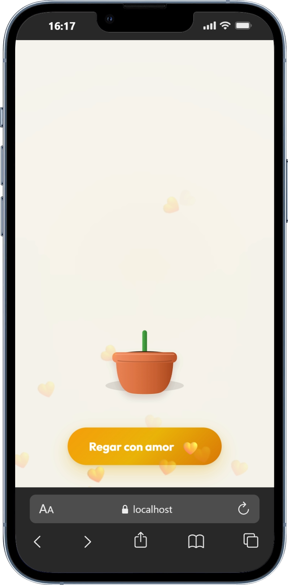

<div align="center">

  <h1>🌻 Para Vos 💛</h1>
  <p><b>Una experiencia interactiva y romántica para celebrar el Día de la Primavera</b></p>

  <p>
    
    
    
    
    
  </p>

</div>

---

## 📸 Galería

<p align="center">
  
  
</p>
<p align="center">
  
  
</p>

---

## ✨ Experiencia y Detalles

- 🪴 **Crecimiento Orgánico e Interactivo**: Acompaña el nacimiento de la planta desde su tallo verde inicial en la maceta hasta desplegar sus hojas con transiciones fluidas y elásticas.
- 💛 **Revelación Progresiva de Frases**: Cada riego abre paso a hermosas razones y mensajes dedicados a esa persona especial.
- 🌻 **Girasol Ilustrado**: Diseño en SVG con pétalos orgánicos superpuestos y un centro de semillas detallado.
- 🎉 **Celebración en Cascada (60 FPS)**: Explosión instantánea de mini girasoles flotantes acelerada por GPU mediante *Offscreen Canvas Sprites*.
- 🎵 **Audio Integrado (Web Audio API)**: Efectos sonoros procedurales para el agua y la fanfarria de celebración final sin dependencias de archivos de audio externos.
- 📱 **Diseño Responsivo e Inmersivo**: Interfaz optimizada con estética *glassmorphism*, paleta cálida y adaptabilidad para dispositivos móviles y escritorio.

---

## 🚀 Instalación y Puesta en Marcha

### Prerrequisitos
- [Node.js](https://nodejs.org/) (versión 18 o superior recomendada)
- Gestor de paquetes `npm`, `pnpm` o `yarn`

### Pasos

1. **Clonar el repositorio:**
   ```bash
   git clone https://github.com/TU-USUARIO/Its.Yellow.Flowers.git
   cd Its.Yellow.Flowers
   ```

2. **Instalar dependencias:**
   ```bash
   npm install
   # o si usas pnpm
   pnpm install
   ```

3. **Iniciar servidor de desarrollo:**
   ```bash
   npm run dev
   # o con pnpm
   pnpm dev
   ```
   Abre la URL indicada en la terminal (usualmente `http://localhost:5173`) en tu navegador.

4. **Compilar para producción:**
   ```bash
   npm run build
   # para previsualizar la compilación:
   npm run preview
   ```

---

## 🎨 ¿Cómo personalizarlo?

Puedes personalizar los textos y mensajes para adaptarlos a tu persona especial:

1. Abre el archivo [`src/App.jsx`](./src/App.jsx).
2. Modifica el arreglo `STAGES`:
   - Cambia las frases en `reasons` que van apareciendo en cada riego.
   - Cambia los textos de los botones (`btnText` y `btnEmoji`).
3. Personaliza la tarjeta final en [`src/components/FinalCard.jsx`](./src/components/FinalCard.jsx) o los mensajes principales.

---

## 🛠️ Tecnologías

- **[React 19](https://react.dev/)** — Interfaz de usuario declarativa y componentizada.
- **[Vite 8](https://vitejs.dev/)** — Herramienta de compilación y servidor ultrarrápido.
- **Canvas API (2D)** — Sistema de partículas de alto rendimiento para la lluvia de girasoles a 60 FPS.
- **Web Audio API** — Generación procedural de efectos de sonido.
- **SVG + CSS3 Moderno** — Animaciones elásticas, transiciones y efectos *glassmorphism*.

---

## 🌐 Despliegue

La carpeta de salida generada con `npm run build` es `/dist`. Puedes desplegarla en un clic en servicios como:
- [Vercel](https://vercel.com/)
- [Netlify](https://www.netlify.com/)
- [GitHub Pages](https://pages.github.com/)

---

<div align="center">
  <br />
  <sub>Creado con todo el amor 💛 para regalar una sonrisa primaveral 🌻</sub>
</div>
